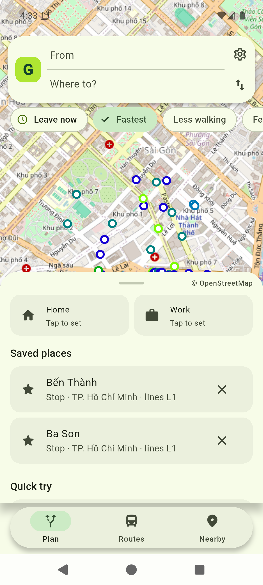
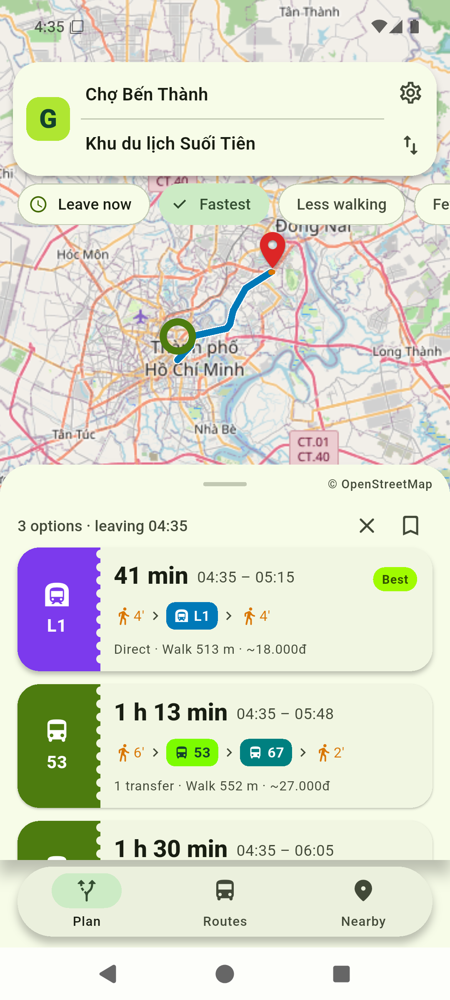
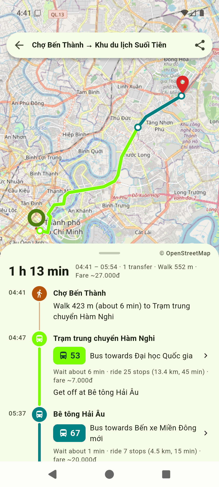
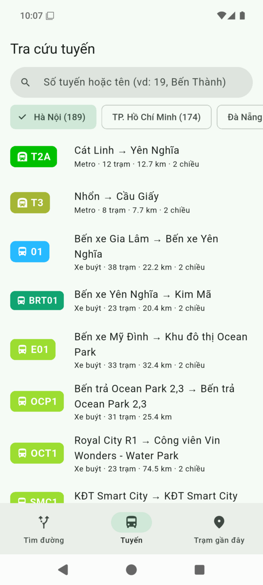
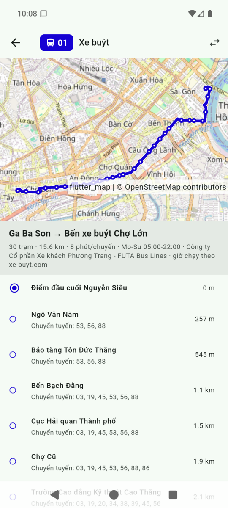
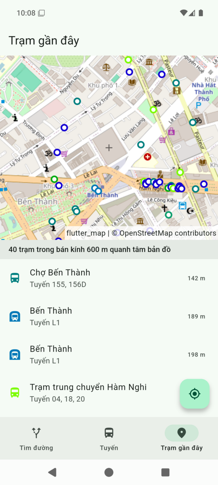

# Lộ Trình Việt (vn-transit-router)

Ứng dụng Flutter (Android + iOS) tìm đường bằng phương tiện công cộng ở Việt Nam: xe buýt, metro, buýt sông và đi bộ.

| Trang chính | Kết quả | Chi tiết lộ trình |
|---|---|---|
|  |  |  |

| Tra cứu tuyến | Chi tiết tuyến | Trạm gần đây |
|---|---|---|
|  |  |  |

## Tính năng

- **Tìm đường**: chọn điểm đi/đến bằng tên địa danh, tên trạm, vị trí hiện tại hoặc ghim trên bản đồ. Gợi ý tối đa 5 lộ trình kết hợp đi bộ, xe buýt, metro, có số lần chuyển tuyến, thời gian, quãng đi bộ và giá vé ước tính.
- **Chi tiết lộ trình**: bản đồ từng chặng và dòng thời gian (đi bộ đến trạm nào, lên tuyến nào, xuống ở đâu).
- **Tra cứu tuyến**: theo tỉnh/thành, tìm theo số tuyến hoặc tên (không cần gõ dấu), xem lộ trình hai chiều, danh sách trạm và các tuyến chuyển tiếp tại mỗi trạm.
- **Trạm gần đây**: trạm trong bán kính 600 m quanh vị trí hiện tại hoặc tâm bản đồ.
- **Tuỳ chọn**: chọn ngày giờ khởi hành; ưu tiên nhanh nhất, ít đi bộ, ít chuyển tuyến hoặc chỉ metro.
- **Yêu thích**: nhà, cơ quan, địa điểm và lộ trình đã lưu.
- **Chi tiết trạm**: các tuyến đi qua trạm, tìm đường từ/đến trạm.
- **Chia sẻ lộ trình**, giao diện sáng/tối, tiếng Việt/tiếng Anh.
- Tìm đường chạy hoàn toàn trên máy với dữ liệu đóng gói sẵn. Cần mạng: ô bản đồ (vùng đã xem được lưu lại để xem offline), tìm địa danh, và đường đi bộ theo phố nếu người dùng chọn tải.

## Dữ liệu

| Nguồn | Dùng cho | Ghi chú |
|---|---|---|
| OpenStreetMap (bản trích Việt Nam của Geofabrik) | Tuyến, trạm, hình dạng tuyến | © OpenStreetMap contributors, giấy phép ODbL |
| xe-buyt.com | Giờ hoạt động và giãn cách chuyến của một số tuyến buýt TP.HCM | Chỉ bổ sung khi OSM chưa có |
| Ô bản đồ OpenStreetMap, Nominatim | Bản đồ nền, tìm địa danh | Cần mạng |
| OSRM (routing.openstreetmap.de) | Đường đi bộ theo phố, chỉ khi người dùng bấm tải hoặc bật trong Cài đặt | Cần mạng, gửi toạ độ hai đầu chặng đi bộ |

Hiện có 923 chiều tuyến và 15.176 trạm: Hà Nội, TP.HCM, Đà Nẵng và hơn 20 tỉnh/thành khác; metro gồm tuyến 1 (TP.HCM), 2A và 3 (Hà Nội).

### Giới hạn

- **Không có lịch chạy thời gian thực.** Thời gian đi tính từ quãng đường và tốc độ trung bình theo loại phương tiện; thời gian chờ bằng nửa giãn cách chuyến (giá trị mặc định khi tuyến không có số liệu).
- **Giá vé là ước tính**: lấy giá ghi trên OSM nếu có, nếu không thì đoán theo thành phố và cự ly tuyến.
- Độ phủ và độ chính xác của tuyến/trạm phụ thuộc OSM; một số tuyến thiếu trạm.
- Chặng đi bộ mặc định vẽ theo đường thẳng, quãng đường nhân hệ số 1,3; đường theo phố chỉ có khi tải online từ OSRM.
- Không có vị trí xe hay giờ đến thực tế: chưa có nguồn dữ liệu mở.

## Cài đặt và chạy

Yêu cầu Flutter 3.47 trở lên (Dart 3.x), Android SDK hoặc Xcode.

```bash
flutter pub get
flutter run            # chạy trên máy ảo/thiết bị đang kết nối
flutter test           # kiểm thử bộ tìm đường trên dữ liệu thật
flutter build apk      # bản Android
```

## Kiến trúc

```
lib/
  data/       geo.dart (khoảng cách, polyline, bỏ dấu), transit_data.dart (mô hình + chỉ mục lưới)
  routing/    router.dart (tìm đường theo vòng, kiểu RAPTOR, tối đa 4 chuyến), fares.dart
  services/   geocoder.dart (Nominatim)
  ui/         planner, place_search, map_pick, itinerary, routes, route_detail, nearby
  app_state.dart   nạp dữ liệu trong isolate, vị trí, địa điểm gần đây
assets/data/transit.json.gz   dữ liệu tuyến/trạm đã nén
tool/         script tạo dữ liệu
```

Thư viện chính: `flutter_map`, `latlong2`, `geolocator`, `provider`, `shared_preferences`, `http`.

## Cập nhật dữ liệu

```bash
pip install osmium
curl -L -o vietnam.osm.pbf https://download.geofabrik.de/asia/vietnam-latest.osm.pbf
python3 tool/extract_osm.py $(date +%F) # tạo transit.json.gz từ OSM
mv transit.json.gz assets/data/ && rm transit.json
python3 tool/merge_schedule.py         # bổ sung giờ chạy từ tool/hcm_schedule.json
python3 tool/fix_routes.py             # sửa riêng từng tuyến theo tool/route_fixes.json
```

`tool/parse_xebuyt.py` tạo `hcm_schedule.json` từ các trang tuyến đã lưu của xe-buyt.com.

## Phát hành

Mã ứng dụng: `dev.dantech.vn_transit` (Android), `dev.dantech.vnTransit` (iOS). Phiên bản đặt ở `version:` trong `pubspec.yaml`.

**Android:** tạo khoá một lần, rồi chép `android/key.properties.example` thành `android/key.properties` và điền thông tin (hai tệp này không được commit).

```bash
keytool -genkey -v -keystore android/upload-keystore.jks -keyalg RSA -keysize 2048 -validity 10000 -alias upload
flutter build appbundle --release   # build/app/outputs/bundle/release/app-release.aab
```

Không có `key.properties` thì bản release được ký bằng khoá debug, chỉ để cài thử.

**iOS:** cần máy macOS và tài khoản Apple Developer. Mở `ios/Runner.xcworkspace`, chọn Team ở Signing & Capabilities, rồi `flutter build ipa --release`.

**CI:** workflow `Release` (chạy tay hoặc khi đẩy tag `v*`) build AAB/APK và bản iOS chưa ký. Để ký Android trên CI, thêm các secret `ANDROID_KEYSTORE_BASE64`, `ANDROID_KEYSTORE_PASSWORD`, `ANDROID_KEY_ALIAS`, `ANDROID_KEY_PASSWORD`.

Biểu tượng: sửa `assets/icon/` rồi chạy `dart run flutter_launcher_icons`.
